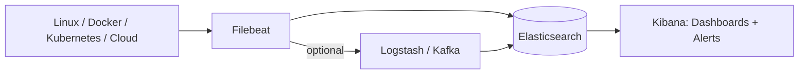

# ELK DevOps Handbook

A practical, hands-on ELK (Elasticsearch, Logstash, Kibana + Filebeat) reference built from real lab implementation: Docker, Linux, Kubernetes (Kind), and cloud (AWS / Azure / GCP) logging – focused on **commands, configs, troubleshooting, dashboards, and interview prep** rather than Elasticsearch internals.

## Project Overview
This repo teaches: ELK fundamentals · log collection from different sources · Docker / Linux / Kubernetes monitoring · cloud log integration · dashboards · alerting · troubleshooting · production best practices.

## ELK Architecture

More: [diagrams/architecture.md](diagrams/architecture.md)

## Learning Roadmap
1. **ELK fundamentals** → [01](docs/01-elk-overview.md), [02](docs/02-elasticsearch-basics.md), [03](docs/03-kibana-basics.md), [04](docs/04-filebeat-basics.md)
2. **Linux + Nginx + Docker logs** → [05](docs/05-linux-server-logs.md), [06](docs/06-nginx-logs.md), [07](docs/07-docker-logs.md)
3. **Kubernetes + Cloud** → [08](docs/08-kubernetes-logs.md), [09 AWS](docs/09-aws-logs.md), [10 Azure](docs/10-azure-logs.md), [11 GCP](docs/11-gcp-logs.md)
4. **Dashboards, alerting, production** → [12](docs/12-dashboard-creation.md), [13](docs/13-alerting.md), [14](docs/14-production-best-practices.md)
5. **Troubleshoot + interview + projects** → [15](docs/15-troubleshooting.md), [16](docs/16-interview-questions.md), [17](docs/17-study-plan.md), [projects](projects/README.md)

## Repository Structure
```
elk-devops-handbook/
├── README.md
├── docs/            # 17 guides (01-elk-overview … 17-study-plan)
├── diagrams/        # Mermaid architecture diagrams
├── screenshots/     # Your dashboard/lab screenshots
├── lab/             # docker-compose: Elasticsearch, Kibana, Nginx
├── filebeat/
│   ├── linux/       # syslog, auth, nginx configs
│   ├── docker/      # container + autodiscover configs
│   ├── kubernetes/  # autodiscover variant
│   └── cloud/       # AWS / Azure / GCP / Logstash
├── kubernetes/
│   ├── kind/              # kind cluster config
│   ├── filebeat-daemonset/ # RBAC + ConfigMap + DaemonSet
│   └── examples/          # nginx, log generator, crashloop pod
└── projects/        # 8 DevOps project ideas
```

## Quick Start Guide
```bash
git clone https://github.com/<you>/elk-devops-handbook.git && cd elk-devops-handbook
sudo sysctl -w vm.max_map_count=262144

docker compose -f lab/docker-compose.yml up -d
curl localhost:9200          # Elasticsearch
curl localhost:5601/api/status   # Kibana  (UI: http://localhost:5601)
curl localhost:8080          # Nginx (generate a log line)
```
> Lab runs with `xpack.security.enabled=false`. **Never do that in production.**

## Real Lab Setup Performed
**Environment:** Ubuntu laptop · Docker · Elasticsearch 8.19 · Kibana 8.19 · Nginx container · Kind Kubernetes cluster · Filebeat DaemonSet

**Docker containers running**
| Container | Role |
|---|---|
| `elasticsearch` | Log store (port 9200) |
| `kibana` | UI (port 5601) |
| `nginx` | Sample app generating access logs |
| `kind-control-plane` | Kind control-plane node (a Docker container) |
| `kind-worker` | Kind worker node (runs Filebeat pod) |

**Commands used**
```bash
docker ps
kubectl get pods
kubectl get svc
kubectl logs <pod>
kubectl exec -it <pod> -- sh
curl localhost:9200
curl localhost:5601
docker logs nginx
filebeat test config
```
**Flow built:** Nginx/pod logs → Filebeat DaemonSet → Elasticsearch (host IP:9200) → Kibana Data View → Discover.

## Docker Logging
Docker's `json-file` driver stores logs at `/var/lib/docker/containers/<id>/<id>-json.log`. Filebeat reads those files (container parser + `add_docker_metadata`).
```bash
docker inspect nginx | grep LogPath
```
Guide: [docs/07](docs/07-docker-logs.md) · Configs: [filebeat/docker](filebeat/docker)

## Kubernetes Logging
Filebeat runs as a **DaemonSet**, reading `/var/log/containers` (symlinks to `/var/log/pods`) and enriching with `add_kubernetes_metadata`.
```bash
kind create cluster --name elk-lab --config kubernetes/kind/kind-config.yaml
sed -i 's/HOST_IP/<your-host-ip>/' kubernetes/filebeat-daemonset/filebeat-daemonset.yaml
kubectl apply -f kubernetes/filebeat-daemonset/filebeat-daemonset.yaml
kubectl -n kube-system logs ds/filebeat --tail=20
```
Guide: [docs/08](docs/08-kubernetes-logs.md)

## Cloud Logging
| Cloud | Path |
|---|---|
| **AWS** | Filebeat on EC2/EKS · CloudWatch → Logstash · ALB → S3 → SQS → Filebeat → [guide](docs/09-aws-logs.md) |
| **Azure** | Diagnostic Settings → Event Hub → Filebeat/Logstash → [guide](docs/10-azure-logs.md) |
| **GCP** | Cloud Logging → Log Router → Pub/Sub → Filebeat → [guide](docs/11-gcp-logs.md) |

## Dashboard Screenshots
Add screenshots to [`screenshots/`](screenshots) and link them here:

<!--  -->
<!--  -->
<!--  -->
<!--  -->

Build guide: [docs/12](docs/12-dashboard-creation.md) (Nginx · Kubernetes · Linux · Application).

## Troubleshooting
Full guide: [docs/15](docs/15-troubleshooting.md). Highlights from the lab:

| # | Problem | Cause | Fix |
|---|---|---|---|
| 1 | Filebeat can't reach Elasticsearch | `host.docker.internal` unreachable from Kind | Use host IP, e.g. `hosts: ["192.168.x.x:9200"]` |
| 2 | Nginx logs not visible in Kibana | Filebeat/ES/index/Data View not verified | Check Filebeat, `curl localhost:9200`, `/_cat/indices?v`, create Data View |
| 3 | Filebeat collecting, Kibana empty | Missing Data View / time range | Check Filebeat logs, indices, create Data View, widen time range |
| 4 | `host.docker.internal` fails in Kind | Kind nodes are Docker containers | Use actual host IP |

## Interview Preparation
20 questions + scenarios with concise answers: [docs/16](docs/16-interview-questions.md). 30-day plan: [docs/17](docs/17-study-plan.md). Portfolio ideas: [projects](projects/README.md).

## License
MIT
