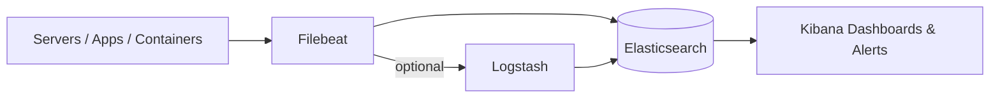
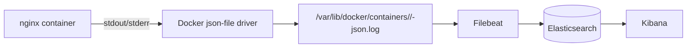
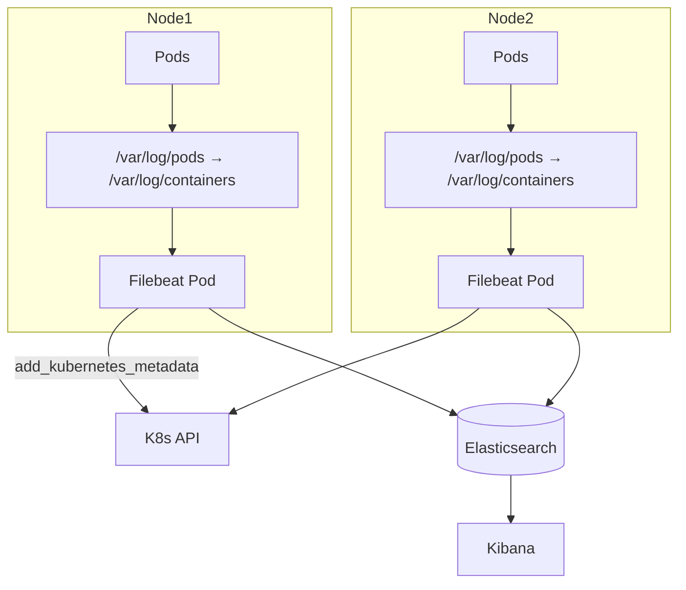
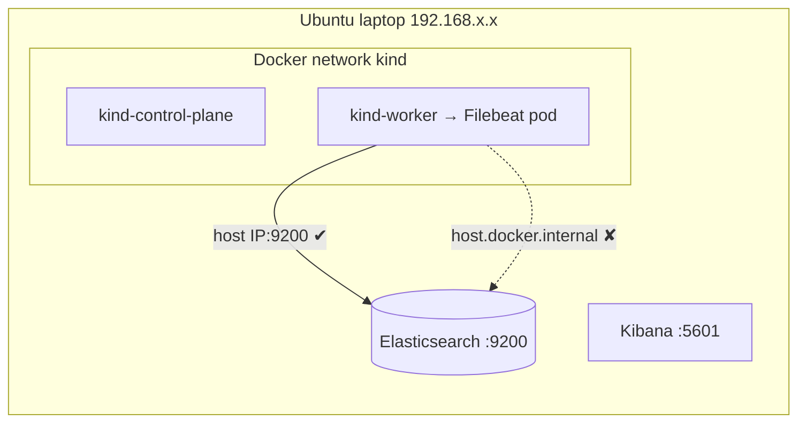
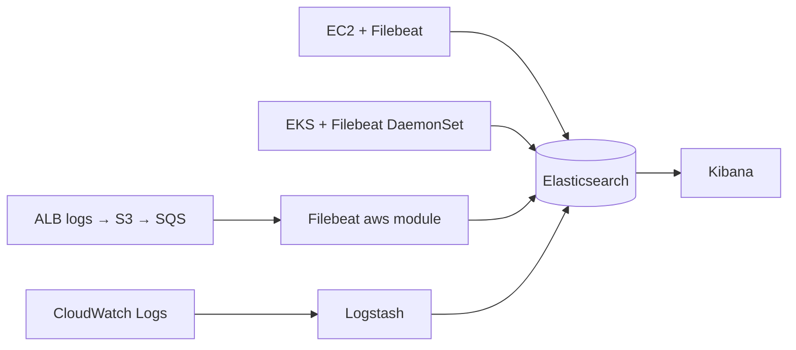
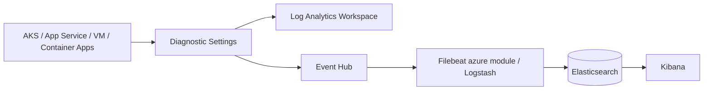
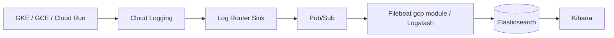
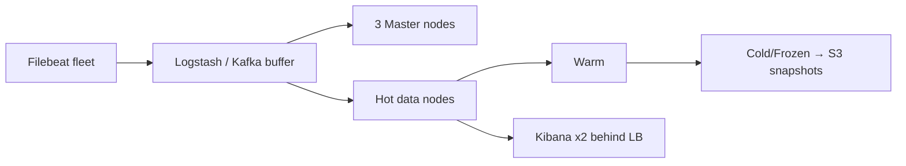

# Architecture Diagrams (Mermaid – renders natively on GitHub)

## 1. ELK Core

## 2. Docker Logging

## 3. Kubernetes (Filebeat DaemonSet)

## 4. Kind Lab Network (why host.docker.internal fails)

## 5. AWS

## 6. Azure

## 7. GCP

## 8. Production

