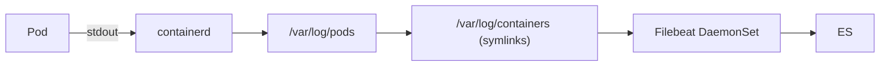

# 08 – Kubernetes Logs

## Log types
| Type | Where | Collected by |
|---|---|---|
| **Pod / container logs** | `/var/log/pods/<ns>_<pod>_<uid>/<container>/*.log` (symlinked from `/var/log/containers/*.log`) | Filebeat DaemonSet |
| **Application logs** | stdout/stderr (preferred) or files in a volume (sidecar needed) | Filebeat |
| **Node logs** | `/var/log/syslog`, `journalctl -u kubelet`, `containerd` | Filebeat on node (system input/journald) |
| **Control-plane logs** | kube-apiserver, scheduler, controller-manager run as static pods → appear in `/var/log/containers`; on managed clouds (EKS/AKS/GKE) use the cloud's log export | Filebeat / cloud pipeline |
| **Ingress logs** | ingress-nginx controller pod stdout | Filebeat |
| **K8s Events** | API object, not a file | `kubernetes.events` metricbeat module or event exporter |

## Why a DaemonSet?
One Filebeat pod per node reads that node's log files from hostPath mounts. No per-app change, scales automatically with nodes.



## Key paths
- `/var/log/containers/*.log` – symlinks named `<pod>_<ns>_<container>-<id>.log`
- `/var/log/pods/` – real files; mount **all of `/var/log`** so symlinks resolve
- `/var/lib/docker/containers` – needed only for Docker runtime nodes (Kind uses containerd, but harmless)

## add_kubernetes_metadata
Queries the K8s API (needs ServiceAccount + ClusterRole `get/list/watch` on pods, namespaces, nodes) and adds:
`kubernetes.pod.name`, `kubernetes.namespace`, `kubernetes.node.name`, `kubernetes.labels.*`, `container.image.name`.
Without RBAC the logs ship but without these fields.

## Deploy (Kind lab)
```bash
kind create cluster --name elk-lab --config kubernetes/kind/kind-config.yaml
kubectl get nodes

# find host IP reachable from the kind network
ip -4 addr show | grep inet            # e.g. 192.168.1.20
# edit HOST_IP:
sed -i 's/HOST_IP/192.168.1.20/' kubernetes/filebeat-daemonset/filebeat-daemonset.yaml

kubectl apply -f kubernetes/filebeat-daemonset/filebeat-daemonset.yaml
kubectl apply -f kubernetes/examples/nginx-app.yaml
kubectl -n kube-system get pods -l app=filebeat -o wide
kubectl -n kube-system logs ds/filebeat --tail=30
kubectl -n kube-system exec ds/filebeat -- filebeat test output -c /etc/filebeat.yml
```
Manifest: [`filebeat-daemonset.yaml`](../kubernetes/filebeat-daemonset/filebeat-daemonset.yaml).

> Kind nodes are Docker containers. `host.docker.internal` is not resolvable there – use the host IP. See [troubleshooting](15-troubleshooting.md).

## Generate data
```bash
kubectl apply -f kubernetes/examples/log-generator.yaml
kubectl apply -f kubernetes/examples/crashloop-pod.yaml
kubectl run curl --rm -it --image=curlimages/curl -- curl -s demo-nginx
```

## Verify
```bash
curl localhost:9200/_cat/indices?v | grep k8s-logs
curl "localhost:9200/k8s-logs-*/_search?q=kubernetes.namespace:default&size=1&pretty"
```

## Autodiscover variant
[`filebeat-k8s-autodiscover.yml`](../filebeat/kubernetes/filebeat-k8s-autodiscover.yml) – per-pod config through annotations (e.g. `co.elastic.logs/module: nginx`).

## Production tips
- Set resource limits; tolerate control-plane taints.
- Use `drop_event` for noisy namespaces (kube-system health probes).
- Run Filebeat in its own namespace and ship through Logstash/Kafka at large scale.
- Managed K8s: enable control-plane logs in the cloud console (EKS/AKS/GKE) and export.
