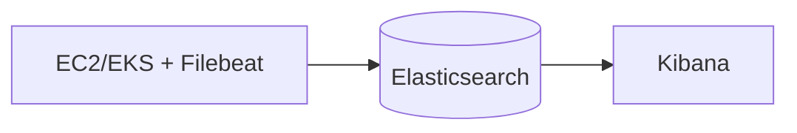
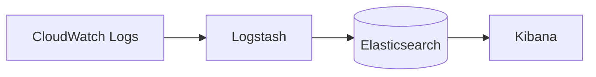
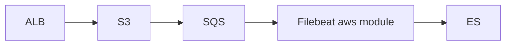

# 09 – AWS Logs → ELK

## Sources and collection method
| Source | Method |
|---|---|
| **EC2 OS/app logs** | Filebeat on instance (systemd) → ES |
| **Nginx logs** | Filebeat nginx module |
| **Application logs** | Filebeat filestream / container |
| **EKS pods** | Filebeat DaemonSet |
| **EKS control plane** (api, audit, authenticator, scheduler) | Enable in EKS → goes to CloudWatch Logs `/aws/eks/<cluster>/cluster` → Logstash/Firehose/Lambda → ES |
| **CloudWatch Logs** | Logstash `cloudwatch_logs` plugin, Kinesis Firehose/subscription filter, or export to S3 |
| **ALB access logs** | ALB → S3 → SQS notification → Filebeat `aws` module (alb fileset) |

Configs: [`filebeat-aws.yml`](../filebeat/cloud/filebeat-aws.yml), [`logstash-cloudwatch.conf`](../filebeat/cloud/logstash-cloudwatch.conf).

## Architectures
**A) Direct**

**B) CloudWatch → Logstash**

**C) S3/SQS**


## Enable EKS control-plane logging
```bash
aws eks update-cluster-config --name my-cluster \
  --logging '{"clusterLogging":[{"types":["api","audit","authenticator","controllerManager","scheduler"],"enabled":true}]}'
```

## ALB logs
```bash
aws elbv2 modify-load-balancer-attributes --load-balancer-arn <arn> \
 --attributes Key=access_logs.s3.enabled,Value=true Key=access_logs.s3.bucket,Value=my-alb-logs
```
Create S3 event notification → SQS, give Filebeat's IAM identity `sqs:ReceiveMessage/DeleteMessage` + `s3:GetObject`.

## IAM – least privilege
Use IRSA (EKS) or instance profiles; never hard-code keys.

## Best practices
- Prefer Filebeat on-node over CloudWatch for cost: CloudWatch ingestion/storage is billed per GB.
- Set CloudWatch retention (e.g. 7–14 days) if ELK is the long-term store.
- Tag fields: `cloud.account.id`, `cloud.region`, env.
- Put ES in same region/VPC to avoid cross-AZ/NAT data charges.
- Alert on ingestion drops (no data for X minutes).
