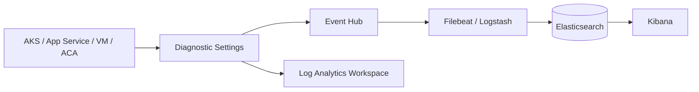

# 10 – Azure Logs → ELK

## Building blocks
- **Azure Monitor** – umbrella service for metrics and logs.
- **Log Analytics Workspace (LAW)** – central log store queried with KQL (Azure's, not Kibana's).
- **Diagnostic Settings** – per-resource config that routes logs/metrics to LAW, Storage, **Event Hub**, or partner solutions.

## Sources
| Source | What to enable |
|---|---|
| **AKS** | Diagnostic setting: kube-apiserver, kube-audit, kube-controller-manager, kube-scheduler; plus Filebeat DaemonSet for pod logs |
| **App Service** | App Service Logs (HTTPLogs, AppServiceConsoleLogs) via Diagnostic Settings |
| **VM** | Filebeat on VM, or Azure Monitor Agent → LAW |
| **Container Apps** | Log destination = Event Hub / LAW |
| **Activity Log** | Subscription-level Diagnostic Setting |

## Export patterns
1. **Diagnostic Settings → Event Hub → Filebeat (azure module) / Logstash (azure_event_hubs input) → ES** – near real time (recommended).
2. **Diagnostic Settings → Storage → Filebeat azure-blob-storage input** – cheap, batch.
3. **LAW → Data export rule → Event Hub/Storage.**

Config: [`filebeat-azure.yml`](../filebeat/cloud/filebeat-azure.yml).



## CLI example
```bash
az eventhubs namespace create -g rg-logs -n ehns-logs -l centralindia
az eventhubs eventhub create -g rg-logs --namespace-name ehns-logs -n aks-logs
az monitor diagnostic-settings create --name to-eh \
  --resource $(az aks show -g rg -n aks1 --query id -o tsv) \
  --event-hub aks-logs --event-hub-rule <auth-rule-id> \
  --logs '[{"category":"kube-audit","enabled":true},{"category":"kube-apiserver","enabled":true}]'
```

## Best practices
- Pick only needed categories (kube-audit is very large).
- One consumer group per consumer; checkpoint to a storage account.
- Use Managed Identity where supported.
- Decide where the source of truth is: LAW (Azure-native) vs ELK; avoid paying for both at full retention.
