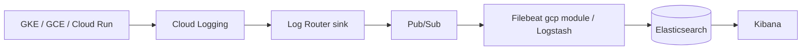

# 11 – GCP Logs → ELK

## Building blocks
- **Cloud Logging** – central log service.
- **Log Router + Sinks** – export logs to Pub/Sub, Cloud Storage, BigQuery.

## Sources
| Source | Notes |
|---|---|
| **GKE** | System + workload logs go to Cloud Logging automatically; or run Filebeat DaemonSet for direct shipping |
| **Compute Engine** | Ops Agent → Cloud Logging, or Filebeat on VM |
| **Cloud Run** | stdout/stderr → Cloud Logging automatically |
| **Audit logs** | Admin Activity / Data Access via Log Router |

## Export to ELK
```bash
gcloud pubsub topics create gcp-logs-topic
gcloud pubsub subscriptions create filebeat-gcp-audit-sub --topic gcp-logs-topic
gcloud logging sinks create to-elk \
  pubsub.googleapis.com/projects/my-project/topics/gcp-logs-topic \
  --log-filter='resource.type="k8s_container" OR resource.type="cloud_run_revision"'
# grant the sink's writer identity roles/pubsub.publisher on the topic
```
Create a service account with `roles/pubsub.subscriber` for Filebeat, mount key (or use Workload Identity on GKE).
Config: [`filebeat-gcp.yml`](../filebeat/cloud/filebeat-gcp.yml).



## Best practices
- Use sink **filters** and **exclusion filters** to control cost.
- Workload Identity instead of JSON keys.
- Keep a short retention in Cloud Logging if ELK is primary.
- Monitor Pub/Sub backlog (undelivered messages) – it indicates Filebeat lag.
